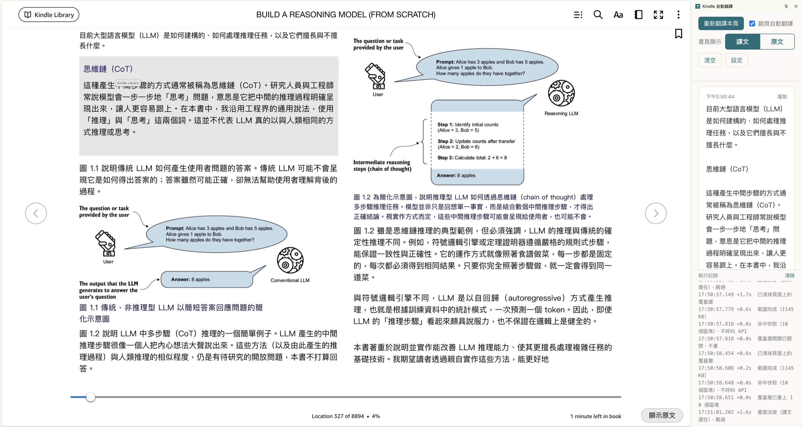

[繁體中文](README.md) | **English**

# Kindle Auto-Translate (Chrome extension prototype)

Captures the page currently shown in Kindle Cloud Reader (read.amazon.com and others), reads each paragraph and its position with local OCR (Tesseract), and has Claude Haiku translate it into Traditional Chinese. The translation is drawn directly over the original text on the page, and also shown in Chrome's side panel.

> **Status: prototype, usable for everyday reading.** Tested on Kindle Cloud Reader's two-page layout: the translation covers the original text about 9 seconds after a page turn. Paragraphs are occasionally split wrongly, and boxes are occasionally a little off. When the overlay doesn't appear, the side panel's status line shows the reason in red, and the log below it shows each step.

The extension's interface is in Chinese; the labels quoted below are followed by their English meaning. The target language can be changed in the options page.

## Install

1. Unzip `kindle-translate.zip` to get the `kindle-translate` folder.
2. Open `chrome://extensions` and turn on "Developer mode" in the top right.
3. Click "Load unpacked" and choose the `kindle-translate` folder.
4. In the extension's "Details → Extension options", enter an Anthropic API key (create one at console.anthropic.com) and save.

## Usage

1. Open Kindle Cloud Reader and open a book.
2. Click the extension's icon in the toolbar to open the side panel.
3. Click 「翻譯這一頁」 (translate this page) or press Alt+T. With 「翻頁自動翻譯」 (translate on page turn) checked, a page is translated about 1 second after you turn to it. When the current page is already translated and the screen hasn't changed, the button becomes 「重新翻譯本頁」 (retranslate this page) and skips the cache.
4. The translation covers the book's paragraphs in place (font size fitted to each box, colors matched to the reader theme). The side panel's 「書頁顯示：譯文｜原文」 (page shows: translation | original) switch, or the small 「顯示原文／顯示譯文」 (show original / show translation) button in the page's bottom-right corner, toggles between them at any time; switching back to the translation is instant, with no new request. Turning or clicking the page clears the overlay until the new page is translated.
5. The newest page's translation is at the top of the side panel, with a 「複製」 (copy) button.

## How it works and caveats

- Pages are only translated automatically while the side panel is open, so no API credit is spent in the background.
- A page is identified by a hash of its text area in the screenshot (excluding the title bar, progress bar and page arrows), so the same page is never sent twice; going back to a translated page uses the cache (cleared when the browser closes). If the screen changes mid-translation, the running request is cancelled and the new page is translated instead.
- The options page offers two engines:
  - **Local OCR + Claude text translation (default)**: Tesseract.js reads the text and its position in the browser (a two-page spread is first split into columns at the blank gutter), lines are grouped into paragraphs, and only the text is sent to Claude. On a two-page spread both columns are sent in parallel. OCR takes about 3 seconds; the screenshot never leaves your computer. Only the English OCR model is bundled for now. The translation model defaults to Haiku 5.5 (about 0.1 US cent per page, about 9 seconds); the options page can switch to Sonnet 5.5 (better translations, about 2 cents per page, somewhat slower). The model occasionally declines a column, citing copyright; that column is then translated as text by Opus 5.5 instead, about 15 seconds for the page.
  - **Opus reads the screenshot**: the screenshot goes straight to Claude Opus 5.5, which finds the paragraphs and translates them. 20+ seconds per page, effort defaults to low. In testing, Sonnet 5.5 and Haiku 5.5 declined book-page screenshots on copyright grounds, so this mode uses Opus only. When a safety classifier declines Opus 5.5, the request is retried on Opus 5, then Opus 4.8.
- The only server contacted is api.anthropic.com. The API key is kept in Chrome sync storage.
- In Opus mode the screenshot is scaled to at most 2576 px on the long edge and 3.7 MP in total before sending; anything larger gets scaled again by the API and the coordinates no longer line up.
- Claude occasionally returns a summary instead of a translation, citing copyright. A summary triggers one automatic retry; if it is still a summary it is shown and labelled 「摘要」 (summary), but not cached.
- Positions are per paragraph, not per line, and boxes are occasionally a little off. In OCR mode paragraphs are split by indentation, line spacing and short lines, which occasionally merges two paragraphs or splits one.
- Recognition gets worse when the book text is small; enlarge the reader font or the window.
- This translates page by page for your own reading. Don't use it to export book content in bulk; that violates Amazon's terms of use.

## Files

- `manifest.json`: Manifest V3 configuration
- `content.js`: detects page turns on the Kindle page (keys, clicks, DOM changes) and draws the translation overlay
- `background.js`: capture, OCR preprocessing, Claude API calls (structured outputs), color sampling, cache
- `ocr-layout.js`: column detection and grouping OCR lines into paragraphs
- `offscreen.html/js`: runs Tesseract in an offscreen document (a service worker can't start a Web Worker)
- `vendor/tesseract/`: Tesseract.js 7.0.0, tesseract.js-core and the English model (Apache-2.0), all bundled in the extension rather than loaded from a CDN
- `sidepanel.html/js`: side panel UI
- `options.html/js`: options page (API key, engine, translation model, effort, target language)
