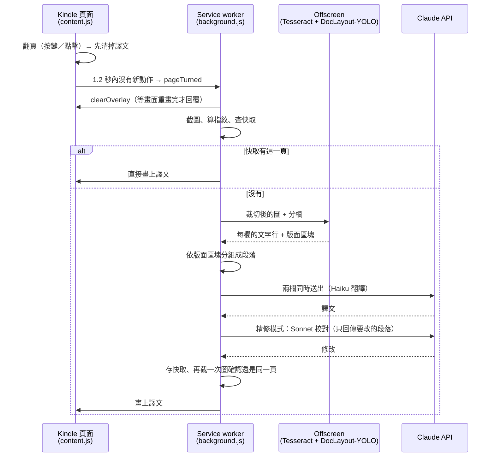

# 設計說明

這份文件說明 Kindle 自動翻譯擴充功能（1.0.1）的內部設計：各元件的分工、一頁從截圖到譯文蓋上去的流程、怎麼判斷「是不是同一頁」、版面偵測、翻譯與校對、快取、以及除錯方式。功能和使用方法見 [README](../README.md)。

每一節除了「怎麼做」，也記下「為什麼這樣做」。很多設計是被實際踩過的問題逼出來的，改動前請先讀對應的段落。

## 1. 元件與分工

| 元件 | 檔案 | 負責 |
|---|---|---|
| Content script | `content.js` | 在 Kindle 頁面偵測翻頁（按鍵、點擊、滾輪、視窗大小、DOM 變動），畫出譯文覆蓋層和右下角切換按鈕 |
| Service worker | `background.js` | 截圖、判斷頁面、排程翻譯工作、呼叫 Claude API、快取、把結果送到頁面和側邊欄 |
| Offscreen 文件 | `offscreen.html/js`、`layout-model.js` | 執行 Tesseract OCR（需要 Web Worker）和 DocLayout-YOLO 版面模型（需要 WebGPU），service worker 兩者都不能直接做 |
| 版面與分段 | `ocr-layout.js` | 分欄、把 OCR 的行依版面模型的區塊分組、沒被框到的行用規則分段；純函式，service worker、offscreen 和 Node 測試共用 |
| 頁面指紋 | `page-sig.js` | 產生頁面指紋、比較兩個畫面是不是同一頁；純函式，共用方式同上 |
| 側邊欄 | `sidepanel.html/js` | 按鈕、譯文／原文切換、狀態列、譯文清單、執行紀錄 |
| 設定頁 | `options.html/js` | API key、翻譯方式、Opus effort、目標語言 |

設定存在 `chrome.storage.sync`；快取、目前顯示的頁面等暫存狀態存在 `chrome.storage.session`（關閉瀏覽器時清除）。Service worker 閒置約 30 秒會被 Chrome 停掉，記憶體裡的變數會消失，所以需要跨越這段時間的狀態都放在 session storage。

## 2. 一頁的流程

### 2.1 觸發

`content.js` 監聽：

- **使用者動作**：方向鍵、PageUp/PageDown、空白鍵、Enter、點擊、滾輪、頂層視窗真的改變大小。這些可能代表翻頁，所以**立刻清掉譯文**，避免舊頁的譯文蓋在新頁上。
- **DOM 變動**：MutationObserver，忽略覆蓋層自己的變動，一次變動至少 2 個節點才算。Kindle 會自己重繪（進度更新、工具列淡入淡出），這類變動**不清掉譯文**，只請背景重新檢查。
- **resize**：Kindle 叫出／收起工具列時也會發出 resize 事件，但視窗大小沒變。只有頂層視窗大小真的改變才算使用者動作，否則當成 DOM 變動。

所有訊號都經過 1.2 秒的 debounce：最後一個動作後 1.2 秒才送 `pageTurned` 給背景。快速連續翻頁時，中間的頁面不會截圖也不會送出請求。

只有側邊欄開著時才會自動翻譯，避免背景偷偷花 API 額度。判斷方式是 `chrome.runtime.getContexts({ contextTypes: ["SIDE_PANEL"] })`，不是看側邊欄的連線：service worker 被停掉後，把它叫醒的那個 `pageTurned` 會比側邊欄重新連線早到，用連線判斷會把這次翻頁丟掉，頁面就停在英文。

### 2.2 清掉譯文再截圖

截圖前要先清掉自己的譯文，不然 OCR 會讀到我們的中文。清掉之後不能固定等一段時間就截圖：書頁在 3 倍解析度下約 1300 萬像素，重畫可能比預期慢，截到殘留的譯文會讓 OCR 讀成亂碼、指紋也對不上。

所以 `clearOverlay` 的回覆會等兩次 `requestAnimationFrame`（第一次在下一次畫面之前，第二次在之後），確定不含譯文的畫面已經畫出來才回覆，背景收到回覆才截圖。分頁在背景時瀏覽器不會畫面，所以另有 0.5 秒的保底逾時。畫上譯文後記錄「有譯文的畫面」時也用同樣的方式等。

`captureVisibleTab` 每秒最多 2 次，所有截圖都經過一個佇列，間隔至少 600 毫秒。

## 3. 判斷是不是同一頁：頁面指紋（`page-sig.js`）

### 3.1 做法

只看閱讀器畫書頁圖片的範圍（跟 OCR 一樣由 content script 回報，見 5.1），四邊再內縮 4 CSS 像素，排除標題列、進度列、翻頁箭頭和書籤。以前用固定比例（`CONTENT_CROP`：寬 9%～91%、高 8%～91%），但標題列固定 62 CSS 像素高，矮的視窗裡會落進來，工具列滑進滑出就被當成翻頁。同一頁兩次截圖必須用同樣的範圍，否則尺寸不同就一定判成不同頁，所以頁面某次回報不了位置時，沿用同一個截圖尺寸上次量到的範圍（存在 session storage）；從來沒量過才用 `CONTENT_CROP`。content script 回報的位置取整數像素，避免小數誤差讓指紋尺寸跳動。把這塊縮成 240 像素寬的灰階圖，跟背景（中位數亮度）差超過 28 的點算「有字」，存成黑白點陣，這就是指紋。

兩個指紋的差異 = 不同的點數 ÷ 有字的點數（取兩者較大的，最少 200）。差異 15% 以下算同一頁。

### 3.2 為什麼不用雜湊

早期用整塊截圖的 SHA-256，只要一個像素不同就算換頁。截圖是 JPEG，工具列動畫、滑鼠效果、反鋸齒都會改變幾個像素，結果同一頁被當成新的一頁：快取對不到、整頁重翻、譯文清掉後蓋不回來。

用真實截圖量過：

| 比較 | 差異 |
|---|---|
| 同一頁，工具列出現／隱藏 | 0% |
| 同一頁，不同時間的截圖 | 0% |
| 同一頁，原文 vs 蓋了譯文 | 55% |
| 不同頁之間 | 95% 以上 |

門檻 15% 離兩邊都很遠。

### 3.3 用到指紋的地方

所有「是不是同一頁」的判斷都只呼叫 `samePage()`，不再自己比較：

- **快取**：`pageIndex` 存 `[id, 指紋]`，查詢時找第一個 `samePage` 的項目，譯文存在 `page:<id>`。最多 500 頁。
- **譯文還在嗎**（`overlaySig`）：畫上譯文後截一張「有譯文的畫面」。之後 Kindle 自己重繪時，拿目前畫面跟它比，同一頁就什麼都不做，不用先清掉譯文，所以不會閃回英文。比較前也會先問頁面「譯文真的顯示著嗎」（`overlayState`），避免存到的是剛好被隱藏時的畫面。
- **翻譯途中換頁了嗎**：見 4.2。
- **跟上一次截圖一樣嗎**（`lastSig`）：一樣的話略過，不重翻。
- **重新翻譯本頁**（`shownSig`）：畫面還是目前譯文那一頁時，按鈕變成「重新翻譯本頁」，按下去略過快取。
- **畫上去之前再確認**：翻譯完成後再截一次圖，確認還是同一頁才畫，不會把一頁的譯文畫到另一頁上。

每次比較的差異百分比都會寫進執行紀錄。

## 4. 翻譯工作的排程

### 4.1 前景工作與排隊

同一時間只有一個**前景工作**：只有它能清掉、畫上譯文和送結果到側邊欄。前景工作還在跑時又有新的觸發，會排進 `pending`，而且最多只排一個，連續觸發會合併：`force` 只要有一個要求就保留；`reason` 只有全部都是 `dom` 時才是 `dom`。前景工作結束後才處理 `pending`。

手動翻譯（按鈕或 Alt+T）會直接取消正在跑的前景工作。

### 4.2 翻頁時移到背景，而不是取消

前景工作還在跑時，有新的觸發就截一張圖，跟這個工作的頁面比對。如果已經換頁：

- 這個工作**不取消**，改成背景工作：繼續跑完，只把結果存進快取，不畫、不送結果。之後翻回那一頁時直接用快取。
- 前景立刻空出來，開始處理新的一頁。
- 背景最多保留 1 個工作。超過時取消最早的一個，但不會取消目前畫面那一頁的工作，因為你可能正翻回去。
- 翻回一頁時，如果它還在背景翻譯，就等它的結果，不會重送一次。等待中又翻走的話，直接放掉等待。

每個工作有自己的 `AbortController`，一路傳到每個 API 呼叫。取消的請求已用掉的 token 照樣計費。

## 5. OCR 與版面偵測

只在翻譯方式 1、2（本機 OCR）使用；方式 3 把截圖直接交給 Opus，見 6.3。

### 5.1 裁切與分欄

- 只讀閱讀器畫書頁的地方。Kindle Cloud Reader 把每一頁畫成一張圖片；截圖前 content script 回報這些圖片的範圍（CSS 像素，`pageGeometry`），`ocrCrop` 換算成截圖的比例。例如 1571×974 的視窗裡，書頁圖片在 157～1414 × 60～884，標題列是 0～62，進度列在 869～931，頁碼在更下面，翻頁箭頭在兩側 55～103 和 1469～1517，都落在範圍外。
- 為什麼不用固定比例：標題列固定 62 CSS 像素高，所以固定的 6% 在高的視窗會切過章名和第一行（`tests/fixtures/` 的兩張截圖就是），在矮的視窗又會包進標題列。換視窗大小、縮放比例或螢幕都一樣適用。
- 頁面回報不了時（沒有 content script，或閱讀器不是用圖片畫書頁）才退回 `OCR_CROP`（寬 9%～93%、高 6%～94%），執行紀錄會寫「用預設範圍」。
- 超過 500 萬像素時等比例縮小。
- `findColumns` 找雙頁中間的空白：在中間 40% 的寬度裡，找每一直行墨水量都很少的最寬區段。允許 3% 的墨水，因為進度列是一條橫跨兩頁的細線。這個區段要超過寬度的 1% 才算頁縫，否則整張當成一欄。

### 5.2 Tesseract（讀文字）

offscreen 文件裡的 Tesseract.js 7.0.0（英文模型，打包在 `vendor/tesseract/`）對每一欄分別辨識。如果整張一起辨識，Tesseract 會把窄窄的頁縫當成字距，把兩頁的行接在一起。每一行回傳位置、文字、信心分數，以及兩個字距數據：最大字距和第一個字的寬度，供規則分段使用。

### 5.3 DocLayout-YOLO（找段落和圖表）

`layout-model.js`，在 offscreen 文件裡和 Tesseract 同時跑。

- **模型**：DocLayout-YOLO 在 DocStructBench 上訓練的版本，ONNX 格式（`doclayout_yolo_docstructbench_imgsz1024.onnx`，75.3 MB），和 BabelDOC 用的同一個檔案。來源、校驗碼、授權見 `vendor/doclayout/`。
- **類別**：title、plain text、abandon（頁首頁尾）、figure、figure_caption、table、table_caption、table_footnote、isolate_formula、formula_caption。
- **執行**：ONNX Runtime Web 1.30.0 的 WebGPU 版本（`vendor/onnxruntime/`），每欄一次，輸入 1024×1024。前處理照模型訓練時的方式：等比例縮放、用灰色（114）補成正方形、BGR、除以 255。輸出每列是 `x1, y1, x2, y2, 信心, 類別`，模型已經做過 NMS。在 M 系列 Mac 上雙頁約 0.25 秒；第一次執行要約 1 秒建立 GPU 管線。
- **下載**：模型不在 repo 裡。第一次需要時從 Hugging Face 下載，校驗 SHA-256 後存進 Cache Storage，之後直接讀。第一頁會等下載完成，進度顯示在側邊欄狀態列。
- **沒有備案**：沒有 WebGPU、下載失敗、校驗不符、建立失敗，都直接讓這頁失敗，側邊欄顯示紅字「DocLayout-YOLO 無法使用：原因」，下一頁再重試。刻意不改用 WebAssembly 或規則分段：同樣的頁面因環境不同而有不同結果，會很難除錯。
- **為什麼不用 WebAssembly**：同一個模型在 Chrome 的 WASM 上每欄 1024 要 6 秒、640 要 2.4 秒，WebGPU 只要 0.1 秒，兩者輸出完全一致。

### 5.4 分組成段落（`groupWithLayout`）

1. 去掉雜訊行（`isText`：沒有字母或數字、信心低於 40、只有一個字而且信心不到 80）。
2. 模型的區塊依信心排序，跟較高信心的區塊 IoU 超過 0.6 的視為重複，丟掉。模型有時會把同一塊同時標成兩種類別。
3. 一行有一半以上落在 figure、table、isolate_formula 裡，就**不翻譯**，留原圖。這些框往外放寬半個行高，因為模型偶爾會切到圖邊緣的字。
4. 其他行放進重疊最多的文字區塊，重疊要超過一半；同一區塊的行合成一段。title 和 abandon 標成標題，其他是段落。
5. 沒被任何區塊框到的行，例如被頁緣切到的最後一行，交給規則分段（`groupParagraphs`）處理，再跟其他段落依位置排序。

### 5.5 規則分段（`groupParagraphs`，只處理沒被框到的行）

這是 1.0 以前的主要分段方式，現在只處理剩下的行：

- **新段落的條件**：行距變大、字高變了、第一行縮排、上一行沒寫滿且下一行的第一個字放得進去（要留一個字高的餘裕，因為靠左對齊的圖說每行本來就長短不一）。
- **大標題**：兩行以上的大字標題，用自己的行距判斷，不受「沒寫滿」影響。
- **圖表**：一行裡字距超過兩個字高，判定為圖表的列；夾在這種列之間、或緊鄰它們的短行，也算圖的一部分，一起略過。超過一半的行都像圖表時不套用，這代表分欄失敗，不是圖表。
- 接行時，行尾的連字號會去掉（`disco-` + `theque`）。

## 6. 翻譯

### 6.1 送出方式

- 段落編上 id，以 JSON 送出，要求以 JSON schema 回傳（`TRANSLATIONS_SCHEMA`：每段的譯文、說明、是否只給了摘要）。
- 雙頁時兩欄分開、同時送出；單欄時依字數切成兩半。輸出速度是瓶頸，平行送出最快。
- 提示詞要求：逐段翻譯、不合併不拆段、依上下文修正 OCR 錯字、頁首頁尾被切斷的段落只翻看得到的部分、雜訊留空、中文用「」與『』。
- Haiku 5.5 關閉 thinking；Sonnet 5.5 不接受關閉，用最低的 `between_tools`。effort 都是 low。

### 6.2 被拒與摘要

- 某一欄翻不到一半的段落，或回報只給了摘要（`isDeclined`），這一欄改用 **Opus 5.5** 翻譯文字。實測 Haiku 偶爾會以版權為由拒絕，Opus 通常會翻。Opus 補翻的那一欄不再送去校對。
- Opus 5.5 被安全分類器擋下時，伺服器端會依序改用 Opus 5、Opus 4.8（`server-side-fallback` beta）。
- 整頁回傳的是摘要時，自動重試 1 次。仍是摘要就顯示並標示「摘要」，但不存快取。
- 不在提示詞裡說服模型繞過版權判斷。

### 6.3 翻譯方式

| 方式 | 流程 |
|---|---|
| 1. 快速 | OCR + 版面 → Haiku 翻譯 |
| 2. 精修（預設） | 同 1，每欄翻完後由 Sonnet 校對。Sonnet 收到原文和初稿，只回傳需要修改的段落（`REVIEW_SCHEMA`），輸出短，所以快又便宜。校對失敗或被拒時沿用初稿。修改的內容會逐段寫進執行紀錄。 |
| 3. 看圖 | 不做 OCR，截圖縮到長邊 2576、總像素 370 萬以內，直接交給 Opus 5.5，由它回傳每個區塊的位置和譯文（`BLOCKS_SCHEMA`）。尺寸超過 API 上限會被再縮一次，座標就對不上。實測 Sonnet 5.5、Haiku 5.5 看書頁截圖會拒絕，所以只用 Opus。 |

API 一律用串流：service worker 的 fetch 超過 30 秒沒有回應會被 Chrome 中止，串流能讓回應標頭馬上回來。每個請求最多等 180 秒。

## 7. 畫上譯文（`content.js`）

- **位置**：區塊位置以視窗比例傳給頁面，頁面依目前視窗大小換算。每個區塊是一個絕對定位的方框，`pointer-events: none`，點擊會穿透到書頁，翻頁和選單都照常可用。
- **顏色**：背景色取方框外圈一圈像素的中位數，文字色取框內和背景差最多的像素，所以白底、米色、深色主題都能自然融入。
- **字級**：每個方框用二分搜尋找出放得下的最大字級。整頁內文統一用各段的中位數，但不超過該段放得下的大小，讀起來像一本書。單行的區塊，例如對話，不參與中位數，並允許延伸到該欄的右緣。
- **高度**：方框可以往上下空白處延伸，最多到與同欄相鄰區塊距離的一半、且不超過半個行高；沒有相鄰區塊的那一側不延伸，以免蓋到閱讀器介面。
- **翻頁計數**：頁面維護一個翻頁計數。清掉譯文時回報目前的計數，畫上譯文時附上這個計數；如果期間翻過頁，計數不同，這份譯文就丟掉不畫。

### 7.1 譯文／原文切換

設定 `overlay` 是唯一的狀態來源，側邊欄切換鈕、右下角按鈕、Alt+O 都只改這個設定。切到「原文」只是隱藏覆蓋層（`display: none`），不刪除，所以切回「譯文」時立刻出現；背景會順便確認畫面還是同一頁。右下角按鈕放在指紋和 OCR 都不看的角落，點它不算翻頁。

### 7.2 重新載入擴充功能

- 重新載入後，已開著的 Kindle 分頁裡，舊的 content script 還在跑，但已經跟擴充功能斷線。安裝或重新載入時，背景會把新版注入所有已開著的 Kindle 分頁。
- 新版建立覆蓋層和按鈕時，會先移除舊版留下的同 id 元素。
- 舊版程式如果發現自己已經斷線（`chrome.runtime.id` 不存在），就什麼都不做，不會再清掉新版的譯文。
- 1.0 以前的舊版沒有這道保護，遇到時重新整理一次 Kindle 分頁即可清掉。

## 8. 除錯

- **執行紀錄**：側邊欄底部，每一步都有時間戳和距上一步的秒數，新的一行出現時自動捲到最後。背景剛被叫醒、側邊欄還沒重新連上時，紀錄會先暫存，連上後補送。
- **Console**：每一行執行紀錄也會印到 Kindle 分頁的 console，前綴 `[Kindle 翻譯]`。可以和頁面本身的狀態對照，也方便用瀏覽器自動化工具讀取。
- **指紋差異**：每次比對都寫出差異百分比。
- **DocLayout-YOLO 狀態列**：側邊欄顯示模型、執行方式（WebGPU）、區塊數、保留原文的圖表數和花費時間，或下載進度、錯誤。
- **沒有任何譯文區塊時**：把當次截圖附在執行紀錄裡，點一下可以放大，方便看 Claude 收到的是什麼。

## 9. 測試

測試在 `tests/`，用 Node 內建的 test runner（Node 22 以上）。唯一的套件是解 JPEG 的 `jpeg-js`：先 `npm install`，再 `npm test`。

擴充功能的原始碼不改，測試用 `node:vm` 像 Chrome 一樣把它們當成 classic script 載入，周圍換成假的（`tests/helpers/`）：

- `load.js`：載入腳本。計時器加快 50 倍，`AbortSignal.timeout` 加快 200 倍，所以 600 毫秒的截圖間隔、1.2 秒的翻頁 debounce、180 秒的 API 逾時都不會拖慢測試。
- `chrome.js`：`chrome.*` API（storage、runtime、tabs、scripting、offscreen 等），測試從 `chrome._` 接上另一端。
- `images.js`：合成的截圖。每頁的「字」位置不同，所以頁面指紋分得出來；可以設定主題（白、米色、深色）、雙頁、譯文覆蓋層、工具列。
- `claude.js`：假的 Messages API，回應用串流（SSE）送出，可以模擬拒絕、錯誤、逾時、備援模型接手。
- `extension.js`：把以上組起來跑 `background.js`，包括假的 Kindle 分頁（content script）、offscreen OCR 和側邊欄。
- `dom.js`：給 `content.js`、`sidepanel.js`、`options.js` 用的最小 DOM，含簡單的文字量測（`fitText` 要用）。

`tests/fixtures/` 是真實的 Kindle Cloud Reader 截圖，只用沒有版權的書。用側邊欄執行紀錄的「存下截圖」存下：它跟翻譯時用同一個 `captureVisibleTab` 呼叫和 JPEG 品質，並先隱藏譯文，所以就是 OCR 實際拿到的畫面。每張的條件（書、頁碼、單頁或雙頁、主題、預期欄數）和書頁圖片的位置記在 `fixtures.json`；「存下截圖」會另外存一個同名的 `.json`，裡面就是這份位置資料。假的 canvas 會解開 JPEG，縮小時取區域平均，所以 `pageSigOf`、`ocrPage` 的裁切與分欄、`finishBlocks` 的取色都用 `background.js` 本身的程式跑在真實畫面上。

涵蓋範圍：

- **`background.js`**：完整流程（截圖、OCR、翻譯、校對、畫上譯文、快取），翻頁移到背景、翻回背景中的頁、背景上限、排隊與取消、Opus 補翻、摘要重試、看圖模式、各種 API 錯誤與逾時、覆蓋層開關和快捷鍵；以及各個輔助函式和 `callClaude` 的請求格式。
- **`content.js`**：翻頁偵測與 debounce、iframe 轉送、覆蓋層的位置和字級、切換按鈕。
- **`ocr-layout.js`、`page-sig.js`**：分欄、分段、版面模型的區塊、頁面指紋的門檻。
- **`offscreen.js`、`layout-model.js`**：OCR 請求、模型下載、快取、校驗、letterbox。
- **`sidepanel.js`、`options.js`**：訊息顯示、按鈕和設定的對應。

Tesseract、ONNX Runtime 和 canvas 都是假的，所以測試不驗證實際的 OCR 結果、模型輸出和影像縮放。這些要用真實截圖手動確認：

- **版面與分段**：對真實截圖跑 Tesseract（`tesseract.js` for Node），比較改動前後的分段結果。
- **版面模型**：用 `onnxruntime-node` 對真實截圖跑 DocLayout-YOLO，把框畫在截圖上目視檢查。
- **頁面指紋**：對真實截圖計算差異。同一頁的各種情況、不同頁之間都要落在門檻的正確一側。

有版權的書的截圖不放進 repo。

## 10. 已知限制

- 只打包英文的 OCR 模型，翻譯方式 1、2 只支援英文書。
- 需要 WebGPU。Chrome 113 以上大多數桌機都有，沒有時翻譯方式 1、2 無法使用。
- 譯文以段落為單位，不逐行對齊。段落很長、譯文比原文長很多時，字會縮小。
- 第一次使用要下載 75 MB 的模型。
- 快取在關閉瀏覽器時清除。
- 這是逐頁截圖翻譯給自己閱讀用，不要拿來大量匯出書本內容，那會違反 Amazon 的使用條款。
