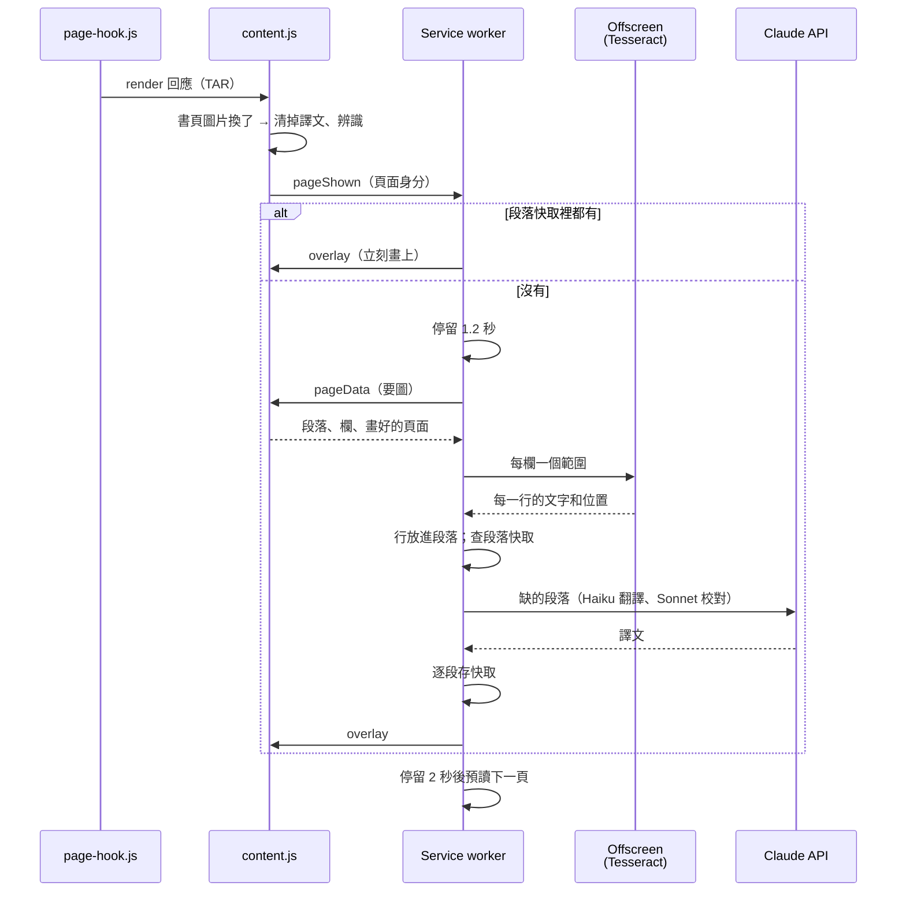

# 設計說明

這份文件說明 Kindle 自動翻譯擴充功能（2.3.0）的內部設計：各元件的分工、閱讀器的頁面資料怎麼拿到、怎麼知道畫面上是哪一頁、一頁從辨識到譯文蓋上去的流程、段落快取、翻譯工作的排程（包括預讀下一頁）、翻譯與校對（包括參考前面的頁）、以及除錯和測試。功能和使用方法見 [README](../README.md)；2.0 這次改動的來由和實測紀錄見 [page-pipeline-v2.md](page-pipeline-v2.md)。

每一節除了「怎麼做」，也記下「為什麼這樣做」。很多設計是被實際踩過的問題逼出來的，改動前請先讀對應的段落。

## 1. 元件與分工

| 元件 | 檔案 | 負責 |
|---|---|---|
| 頁面掛鉤 | `page-hook.js` | 在 Kindle 頁面自己的 JavaScript 環境裡包住 `fetch`，把閱讀器拿的頁面資料複製一份給 content script |
| Content script | `content.js` | 保留頁面資料、發現書頁圖片換了、辨識是哪一頁、回答背景程式的詢問、畫出譯文覆蓋層和右下角切換按鈕 |
| 頁面資料 | `page-render.js` | 解開頁面資料（TAR）、版面鑰匙、段落與欄、照資料把頁面畫出來、逐像素比對；純函式，content script 和 Node 測試共用 |
| Service worker | `background.js` | 決定什麼時候翻哪一頁、OCR 的段落對應、呼叫 Claude API、段落快取、前景／背景／預讀工作、把結果送到頁面和側邊欄；看圖模式的截圖 |
| Offscreen 文件 | `offscreen.html/js` | 執行 Tesseract OCR（需要 Web Worker，service worker 不能開） |
| OCR 分段 | `ocr-layout.js` | 把 OCR 讀到的行和字放進頁面資料說的段落，標出每個字的樣式；純函式，service worker 和 Node 測試共用 |
| 參考段落 | `context-pages.js` | 校對時參考前面的頁：合併、挑選段落，切成穩定的 block；純函式，service worker 和 Node 測試共用 |
| 樣式標記 | `styled-text.js` | 帶 `<i>`、`<b>`、`<h1>` 標記的文字：組出、檢查、拿掉、切分到兩欄；service worker、content script 和 Node 測試共用 |
| 側邊欄 | `sidepanel.html/js` | 按鈕、譯文／原文切換、狀態列、譯文清單、執行紀錄、存下頁面資料 |
| 設定頁 | `options.html/js` | API key、翻譯方式、預先翻譯下一頁、參考前面的頁、Opus effort、目標語言、開發者開關 |

設定存在 `chrome.storage.sync`；快取、目前畫面等暫存狀態存在 `chrome.storage.session`（關閉瀏覽器時清除）；校對用的參考段落（7.6）存在 `chrome.storage.local`，保留 1 週。Service worker 閒置約 30 秒會被 Chrome 停掉，記憶體裡的變數會消失，所以需要跨越這段時間的狀態都放在 session storage。

## 2. 閱讀器的頁面資料

### 2.1 Kindle Cloud Reader 怎麼畫書頁

- 閱讀器向 `https://read.amazon.com/renderer/render` 要頁面，回應是 TAR，一次 6 個畫面（跨頁顯示時一個畫面就是一個跨頁）。裡面沒有圖片，全是 JSON：每個畫面的文字串（字形編號、位置、字型、字級、粗細、斜體、顏色、位置編號）和插圖的位置，以及字形的向量輪廓。
- 閱讀器在瀏覽器裡照這些資料把畫面畫成一張圖，放在 `div.kg-full-page-img > img`（`blob:` URL）。DOM 裡只有目前這一頁。
- 它會先拿好前後十幾個畫面；翻頁時不發請求，直接畫下一個畫面，換一個新的 blob URL。改字級、主題、單欄／雙欄或視窗大小時，從目前這一頁重新拿一批。
- 字形只有編號，沒有對應的字元，所以讀不出文字，文字仍然要 OCR。
- 有些項目帶著背景裝飾（`backDecoration`）：`group` 的 `fillStroke` 是提示框、側欄的灰底方塊，`textline` 的 `linkLine` 是連結的底線。
- `rasterScale` 跟著螢幕的像素密度（實測 2 或 3），一律照請求參數。

### 2.2 旁聽（`page-hook.js`）

`manifest.json` 的第一個 content script，`"world": "MAIN"`、`"run_at": "document_start"`：在閱讀器的程式之前包住 `window.fetch`。網址是 `/renderer/render` 時，`clone()` 一份回應，把位元組用 `postMessage` 交給 content script（transfer，不複製），原本的回應照常還給閱讀器。

- 不對 Amazon 發出任何閱讀器本身沒有發的請求，只旁聽。
- 包裝裡的錯誤一律接住；失敗的回應（非 2xx）不複製。
- 載入兩次也只包一次（`__kindleTranslatorHook`）。

### 2.3 保留（`content.js`）

- 只接受來自同一個視窗、網址是 `/renderer/render`、內容是 ArrayBuffer 的訊息。解不開（`parseRender` 丟錯）就在執行紀錄寫「看不懂」，不保留。
- **版面鑰匙**：`asin`、`revision`、字型、字級、行距、`dpi`、`width`、`height`、四邊邊界、`maxNumberColumns`、`theme`、`rasterScale` 串起來（`layoutOf`）。同一個位置在不同版面下會排成不同的畫面，所以「哪一頁」一定要連同版面鑰匙一起說。
- 同一個版面鑰匙的批次合併，畫面依起始位置編號。**字形不合併**：每批的 `glyphs.json` 都重新編號，同一個編號在另一批是別的字形，所以每個畫面記住自己那一批的字形，畫的時候只用它們。（實作時曾經把各批的字形合併，結果後來的批次蓋掉前面的同號字形：換頁後的頁都認不出來，OCR 也讀出亂碼。）最多保留 2 個版面、每個版面 40 個畫面；超過時丟掉離目前畫面最遠的、或沒在用的版面。
- 每收到一批，在執行紀錄寫「收到閱讀器的頁面資料：N 個畫面」，方便確認旁聽還有效。沒有畫面的回應（在書的開頭往前要頁）直接略過。

### 2.4 畫出頁面（`renderPage`）

在 canvas 上先畫灰底方塊（`fillStroke`），再依序畫每個文字串的每個字形：`Path2D(字形輪廓)`，`setTransform` 用文字串的 `transform` 加上該字形的 `xPosition`，再依 `fontSize / unitsPerEm` 縮放，乘上 `rasterScale`。背景用 `page.fillColor`，字用 `run.textColor`。插圖和連結底線不畫。

實測（見 page-pipeline-v2.md §2.4）：這樣畫出來的跟閱讀器顯示的圖，插圖以外**逐像素相同**，白、米色、深色三種主題和單欄、雙欄都一樣。

## 3. 畫面上是哪一頁

### 3.1 發現換頁

content script 的 MutationObserver 看書頁圖片的 `src`。換了就是閱讀器重畫了畫面（翻頁、跳頁、改設定、改視窗大小都會）。這時：

1. **立刻清掉譯文**。MutationObserver 的回呼在下一次畫面之前執行，所以舊頁的譯文不會疊在新頁上。
2. 等圖片載入完成，辨識它是哪一頁（3.2）。圖片在等待中又換了，舊的辨識立刻讓位（被換掉的圖片可能永遠不會觸發 load）；背景程式問 `currentPage` 時，等到最新的辨識結束才回答。
3. 送 `pageShown` 給背景：辨識到的畫面，或失敗的原因。

覆蓋層本身的 DOM 變動不看。`src` 沒變的 DOM 變動（工具列、進度、游標）什麼都不做，所以閱讀器自己重繪時譯文不會閃。

以前（1.x）要靠按鍵、點擊、滾輪猜翻頁，再截圖比粗略的指紋。截圖會被工具列、游標、JPEG 雜訊、我們自己的譯文干擾，周圍長出一整套容忍誤差的機制。2.0 全部拿掉了。

### 3.2 辨識（`identifyScreen`）

把書頁圖片畫到 canvas 取出像素，跟頁面資料裡的候選畫面逐一比對：

- 先比尺寸：圖片大小要等於 `畫面寬高 × rasterScale`，不符的候選連畫都不畫。
- 版面由新到舊；同一個版面裡，從上一頁附近找起，往後的優先（`distance` 對往前的乘 1.5），一般翻頁第一、二個候選就中。
- 把候選畫出來，跟圖片逐像素比。不比的範圍（`compareMasks`）：插圖（外擴 1 像素）、灰底方塊的四條邊（各外擴 `rasterScale` + 2 像素，閱讀器畫邊緣時取整的方式不同，實測差 1 像素左右）、連結底線（細線，位置總有一點差）。沒排除這些時，有灰框的頁差異約 0.09%，太接近門檻，有時認不出來。R+G+B 差超過 30 才算不同；不同的像素不超過 0.1% 就是這一頁。超過門檻就提早停止計算。
- **大半是插圖的畫面**：插圖遮掉後只剩空白邊緣，跟任何畫面都比得上。遮掉超過一半的候選只當備案，繼續找有更多可比的候選，都沒有才用它。

結果是**頁面身分**：`{ key（版面）, start, end（位置範圍）, asin, revision, width, height, fill, ink }`。

**辨識失敗**時不退回任何備案，側邊欄顯示原因：

- 「還沒收到閱讀器的頁面資料，請重新整理 Kindle 分頁」：通常是擴充功能在閱讀途中重新載入，錯過了先前的批次。
- 「閱讀器的頁面資料裡找不到目前這一頁」：這一頁的批次還沒到；下一批到時會自動再辨識。

刻意不退回截圖流程：同樣的頁面因環境不同而走不同的路，會很難除錯（同 1.x 對版面模型的決定）。

### 3.3 回答背景程式

| 訊息 | 回覆 |
|---|---|
| `currentPage` | 目前的頁面身分；辨識中就等它完成 |
| `pageData`（`key`、`start`，可選 `next`、`image`） | 畫面資訊、段落（`pageParagraphs`）、欄（`pageColumns`）；`image` 時附上畫好的 PNG 和比例。`next` 是下一個畫面，跟這一頁之間的位置空隙超過 5 就當作還沒拿到 |
| `overlay` | 畫上譯文（第 8 節），頁面身分不是目前這一頁就拒絕 |
| `clearOverlay` | 清掉譯文，等畫面重畫完才回覆（看圖模式截圖前用） |
| `geometry` | 書頁圖片在視窗中的位置（看圖模式用） |
| `dumpPage` | 目前畫面的頁面資料（只附用到的字形），除錯用 |

## 4. 一頁的流程

- **自動翻譯只在側邊欄開著時**：判斷方式是 `chrome.runtime.getContexts({ contextTypes: ["SIDE_PANEL"] })`，不是看側邊欄的連線。Service worker 被停掉後，叫醒它的那個 `pageShown` 會比側邊欄重新連線早到。
- **快取的譯文不等**，換頁就畫。要送 API 的才等畫面停留 1.2 秒（`SETTLE_MS`），快速連續翻頁時中間的頁不會送出。
- 手動翻譯（按鈕、Alt+T）不等。

## 5. 段落快取

存在 `chrome.storage.session`：

| 鍵 | 內容 |
|---|---|
| `para:<asin>:<revision>:<start>-<end>` | 一段的原文（OCR）、譯文、時間。跟版面無關 |
| `page:<版面鑰匙>:<start>` | 這個畫面在這個版面下分成哪幾段：每段的位置範圍、種類、欄、外框、字色、OCR 原文；以及畫面大小、底色 |
| `vision:<版面鑰匙>:<start>` | 看圖模式的整頁結果（第 9 節） |
| `cacheIndex` | 段落和畫面的先後，用來淘汰 |
| `shown`、`drawn` | 目前畫面、譯文畫在哪一頁 |

- **為什麼以段落為單位**：同一段文字的位置範圍在任何字級、視窗寬度、單雙欄下都一樣（實測見 page-pipeline-v2.md §2.4），所以譯文可以跨版面重用。改字級或視窗大小後，只有被頁緣切斷的段落（範圍跟著切點變）要重翻。
- **畫面紀錄**省掉同一個畫面重做 OCR；座標跟著版面，存在畫面紀錄裡。
- 上限：段落 5000 個、畫面 500 個，超過時丟掉最舊的。寫入一個個排隊（`cacheChain`），一次失敗不影響下一次。
- **Chrome 的容量上限**：session storage 最多 10 MB，比上面的個數先用完。2.3.0 之前，在同一個瀏覽器工作階段連續讀約 30 個雙頁畫面就會滿，之後每一頁都因為存不進快取而翻譯失敗（「Session storage quota bytes exceeded」）。現在寫入碰到容量錯誤時，丟掉段落和畫面各自較舊的一半（這次要寫的除外）再寫一次，執行紀錄寫出丟了幾筆和用了多少空間。畫面紀錄裡 OCR 字的座標也只存到小數一位。
- 摘要（7.2）不存。
- **按鈕**：目前畫面的譯文已經畫上（`drawn` 是這一頁）時，按鈕是「重新翻譯本頁」：略過段落快取重新請求，但不重做 OCR。否則按鈕先用快取，沒有才翻。

## 6. 翻譯工作的排程

一個工作就是「翻譯一個畫面缺的段落」，結果一律逐段存進快取。三種：

| | 前景 | 背景 | 預讀 |
|---|---|---|---|
| 對象 | 畫面上這一頁 | 翻走時還沒翻完的頁 | 下一頁 |
| 最多幾個 | 1 | 1（`MAX_BACKGROUND`） | 1 |
| 完成時 | 還是這一頁就畫上、送側邊欄 | 只存快取 | 只存快取 |

- **翻頁時不取消**：前景工作改成背景，繼續翻完、存快取。已經付了的 token 結果留著，在任何版面都用得上。背景超過 1 個時才取消最早的一個。
- **不重複付錢**：正在別的工作裡翻的段落（`inflight`），新的工作等它的結果，不重送；那個工作失敗或被取消，等的一方再自己送一次。正在辨識（OCR）的畫面（`reading`）也一樣。
- **手動翻譯**（按鈕、Alt+T）時這一頁正在翻，就等它完成，不重送；只有「重新翻譯本頁」又按一次時，才取消正在跑的重新翻譯重來。取消的請求已用掉的 token 照樣計費。
- Claude 留白的段落（它判斷是雜訊）也存進快取（空字串），不會每次回到這一頁都再問一次。
- **只畫目前這一頁**：連續快速換頁時，幾個畫面的處理可能重疊；畫之前一律確認它還是目前畫面，不是就不畫、也不送側邊欄。頁面因為已經換頁而拒絕譯文時只寫進執行紀錄，不顯示紅字。
- 每個工作有自己的 `AbortController`，一路傳到 OCR 之後的每個 API 呼叫。工作執行中每 20 秒呼叫一次擴充功能 API，讓 service worker 不被停掉（讀串流本身不算）。

### 6.1 預讀下一頁

畫上一頁的譯文後（不論是剛翻好還是來自快取），停留 2 秒（`PREFETCH_DWELL_MS`）就開始翻下一頁。條件全部成立才開始：

1. 還是同一頁、側邊欄開著、「翻頁自動翻譯」和「預先翻譯下一頁」都開著、有 API key、翻譯方式是 1 或 2。
2. 沒有預讀在跑，沒有背景工作在跑（同時跑等於一次付兩頁）。
3. 頁面資料裡有下一頁，而且它還沒翻好。

不成立的原因寫進執行紀錄（「沒有預讀下一頁：…」、「下一頁已經翻好」）。預讀不改側邊欄的狀態列；失敗只寫執行紀錄，不顯示紅字。翻到預讀中的頁時，前景工作等它（上面的不重複付錢）。跳頁、往回翻時預讀不取消，結果照樣存快取。

照順序往後讀、每頁停留超過一頁的翻譯時間時，第二頁起每一頁都是換頁就畫上。浪費的是停止閱讀時的最後一頁，以及跳走前預讀好卻沒讀到的頁。

## 7. 翻譯

### 7.1 OCR 與段落

- **分段不靠猜**：頁面資料裡同一個 `elementId` 的文字串就是一段（書的原始檔裡的一個段落或標題）。段落的位置範圍是這些文字串的最小到最大位置編號；外框在每一欄各取文字串外框的聯集，所以從左頁接到右頁的段落有兩個框；行數是不同基線的數目。
- **標題**：字級是這一頁內文（最多字形用的字級）的 1.2 倍以上，或整段粗體而且只有一兩行。
- **欄**：文字串分布在頁面中線兩側、沒有一個跨過中線時是兩欄（跨頁），否則一欄。
- **OCR 只讀字**：background 向頁面要畫好的頁面（`rasterScale` 倍，不論主題一律畫成白底黑字，Tesseract 讀亮字暗底比較差），每欄交給 Tesseract 讀一次（整張一起讀，Tesseract 會把頁縫當成字距，把兩頁的行接在一起）。每一行放進外框涵蓋它最多（超過一半，外框放寬 4 像素）的段落，依框、再依上下順序接起來；行尾的連字號會去掉（`disco-` + `theque`）。沒落在任何段落的行（插圖邊緣的雜點）丟掉。雜訊行（沒有字母或數字、信心低於 40、只有一個字而且信心不到 80）先濾掉。
- 插圖不畫，所以插圖裡的字不會被讀到、也不會被翻譯，原圖照樣露出來。
- OCR 沒讀到字的段落不送翻譯。

1.x 用 DocLayout-YOLO 版面模型（WebGPU，75 MB）找段落和圖表，2.0 由頁面資料取代，模型、ONNX Runtime 和 WebGPU 的需求都拿掉了。

### 7.2 送出方式

- 段落編上 id，以 JSON 送出，要求以 JSON schema 回傳（`TRANSLATIONS_SCHEMA`：每段的譯文、說明、是否只給了摘要）。
- 雙頁時兩欄分開、同時送出；單欄時依字數切成兩半；少於 4 段時一次送。輸出速度是瓶頸，平行送出最快。
- 提示詞要求：逐段翻譯、不合併不拆段、依上下文修正 OCR 錯字、頁首頁尾被切斷的段落只翻看得到的部分、雜訊留空、中文用「」與『』。
- Haiku 5.5 關閉 thinking；Sonnet 5.5 不接受關閉，用最低的 `between_tools`。effort 都是 low。
- API 一律用串流：service worker 的 fetch 超過 30 秒沒有回應會被 Chrome 中止，串流能讓回應標頭馬上回來。每個請求最多等 180 秒。

### 7.3 被拒與摘要

- 某一欄翻不到一半的段落，或回報只給了摘要（`isDeclined`），這一欄改用 **Opus 5.5** 翻譯文字。實測 Haiku 偶爾會以版權為由拒絕，Opus 通常會翻。Opus 補翻的那一欄不再送去校對，另一欄照樣校對。
- Opus 5.5 被安全分類器擋下時，伺服器端會依序改用 Opus 5、Opus 4.8（`server-side-fallback` beta）。
- 回傳的是摘要時（旗標、說明裡有「摘要」、或譯文以「（摘要）」開頭），自動重試 1 次。仍是摘要就顯示並標示「摘要」，但不存快取。
- 不在提示詞裡說服模型繞過版權判斷。

### 7.4 翻譯方式

| 方式 | 流程 |
|---|---|
| 1. 快速 | OCR → Haiku 翻譯 |
| 2. 精修（預設） | 同 1，兩欄都翻完後，整頁一次由 Sonnet 校對（`reviewDrafts`）。Sonnet 收到原文和初稿，只回傳需要修改的段落（`REVIEW_SCHEMA`），輸出短，所以快又便宜；時間主要在首個 token 之前，所以不像翻譯那樣拆開平行。校對失敗或被拒時沿用初稿。修改的內容會逐段寫進執行紀錄。 |
| 3. 看圖 | 見第 9 節 |

### 7.5 文字樣式與螢光標記

詳細設計和實測見 [text-styles.md](text-styles.md)。

- **斜體、粗體**：段落裡跟大多數字樣式不同的文字串（一般段落裡的斜體、粗體），`pageParagraphs` 給出它們在頁面上的範圍（`styleBoxes`，由字形的 x 位置算出；一行裡不同樣式是不同的文字串，共用行首）。
- **螢光標記**：閱讀器疊在書頁圖片上的 DOM 元素（`.kg-client-highlight`，class 裡有位置範圍）。content script 讀出位置範圍、計算後的背景色和它們在頁面上的範圍，放在頁面身分的 `highlights` 裡；標記增減時再送一次 `pageShown`（同一頁），等標記穩定 300 毫秒才送：閱讀器加一個標記時，會先拿掉所有標記再全部重畫，不等的話會先報「沒有標記」再報回來。標記不在書頁圖片裡，不影響辨識頁面。
- **對到字**：OCR 回傳每個字的框；字的中心點落在哪個範圍，就有那個樣式。畫面紀錄存每個字（文字、位置、斜體／粗體）。
- **送給 Claude**：翻譯前把字組成帶標記的原文（`<i>`、`<b>`、`<h1>`、`<h2>`…，螢光標記依顏色編號），提示詞加一條保留標記的規則；沒有標記的段落和請求照舊，提示詞不變。回來的譯文標記不成對、交錯或用了原文沒有的名稱，就拿掉標記、保留文字，寫一行執行紀錄。
- **快取**：有螢光標記的段落，鑰匙後面加上標記的雜湊（範圍和顏色），所以加、刪標記只重翻那一段；拿掉標記後又用回原本的快取。
- 側邊欄的譯文清單不帶標記。

### 7.6 校對時參考前面的頁與人名對照表

設定頁開啟後（預設關閉，主要用於精修模式），Sonnet 校對時會先看到同一本書在本頁之前讀過的段落（原文和定稿的譯文），用來統一專有名詞、稱呼和語氣；另外每本書記一份人名對照表，每次翻譯和校對都照它翻人名。詳細設計、成本和還沒做的實測見 [reference-pages.md](reference-pages.md)。

- **來源**：譯文畫上時（`draw`），把畫面每一段的原文和譯文存進 `chrome.storage.local` 的 `ref:<asin>:<revision>`，以位置範圍為身分，跟版面無關；重疊的舊段落換成新的。超過 7 天的段落、7 天沒讀的書在寫入時刪掉。
- **挑選**（`pickReference`）：只挑位置在本頁之前的段落。參考集從 `refStart` 開始往後長，超過上限（預設 10000 tokens）時一次丟掉較舊的一半；往回翻到 `refStart` 之前時重新起算。這樣參考集的開頭很少變，prompt cache 才會命中。
- **送出**：content 是「固定的說明、參考段落、本頁的校對 prompt」。參考段落切成約 1000 tokens 一個 block，最後一個封起來的 block 和最後一個 block 各放一個 cache breakpoint：prompt caching 在 block 邊界比對，往後讀時前面的 block 不變，每頁只寫入最後一個。
- 執行紀錄寫出送了幾段、位置範圍、估計的 tokens，沒送時寫原因；API 回報的快取讀寫量寫在「回應結束」那一行。
- **人名對照表**：校對多回傳這一頁的人名和譯名（`REVIEW_NAMES_SCHEMA`），存進 `names:<asin>:<revision>`。只存單一的名或姓，全名拆開存（不然「Wiggin → 懷金」和「Ender Wiggin → 安德・維金」會並存）。先到先贏，已有的譯名不會被改掉；每個名字最後一次出現後保留 30 天。這一頁原文出現的名字附在 Haiku、Opus 補翻和 Sonnet 校對的 prompt 裡（在 cache breakpoint 之後，不影響參考段落的快取）。

## 8. 畫上譯文（`content.js`）

- **位置**：段落的外框是頁面座標（CSS 像素，相對於書頁）。content script 依書頁圖片目前在視窗中的位置換算，視窗大小改變時跟著重新擺放。每個框是一個絕對定位的方框，`pointer-events: none`，點擊會穿透到書頁，翻頁和選單都照常可用。
- **跨欄的段落**：每個框一個方框，譯文依兩部分的行數比例切開，切點挑附近的標點或空白；跨過切點的樣式在兩邊都保留。
- **樣式**：譯文的標記用 DOM 節點畫（`span`、`textContent`，從不把模型的輸出當成 HTML）：斜體用楷體（`BiauKai`、`Kaiti TC`、`STKaiti`、`KaiTi`，沒有楷體時用襯線體），粗體 700，螢光標記用閱讀器的顏色當底色。
- **顏色**：底色是頁面的 `fillColor`，字色是該段大多數字形的顏色，所以白底、米色、深色主題和彩色標題都對得上。不再從截圖取色。
- **字級**：每個方框用二分搜尋找出放得下的最大字級。整頁內文統一用各段的中位數，但不超過該段放得下的大小，讀起來像一本書。單行的段落（例如對話）不參與中位數，並允許延伸到該欄的右緣。
- **高度**：方框可以往上下空白處延伸，最多到與同欄相鄰方框距離的一半、且不超過半個行高；沒有相鄰方框的那一側不延伸。
- **只畫目前這一頁**：譯文訊息帶著頁面身分，跟目前辨識到的不同就丟掉不畫（取代 1.x 的翻頁計數）。
- **圖層**：覆蓋層放在書頁上面一層、閱讀器的工具列和選單下面，所以設定面板滑出來時不會被譯文蓋住。閱讀器把書頁容器放在 z-index -3、整個 app（工具列、選單）在 0，覆蓋層取書頁圖片最外層有 z-index 的祖先再加 1（-2）；找不到時才放在最上層。右下角的切換按鈕仍然在最上層。

### 8.1 譯文／原文切換

設定 `overlay` 是唯一的狀態來源，側邊欄切換鈕、右下角按鈕、Alt+O 都只改這個設定。切到「原文」只是隱藏覆蓋層（`display: none`），不刪除，所以切回「譯文」時立刻出現。覆蓋層關著時翻好的頁沒有畫上去，切回譯文時背景程式從快取畫上（不再新增側邊欄的項目）。

### 8.2 重新載入擴充功能

- 安裝或重新載入時，背景程式把兩個 content script（`page-hook.js` 在頁面自己的環境、`page-render.js` + `content.js`）注入所有已開著的 Kindle 分頁。它們錯過了先前的頁面資料，要等閱讀器拿下一批（翻幾頁、或改一次設定）才辨識得到；重新整理分頁最快。
- 新版建立覆蓋層和按鈕時，會先移除舊版留下的同 id 元素。舊版程式發現自己已經斷線（`chrome.runtime.id` 不存在）就什麼都不送。

## 9. 看圖模式（方式 3）

不做 OCR，把截圖交給 Opus 5.5，由它回傳每個區塊的位置和譯文（`BLOCKS_SCHEMA`）。實測 Sonnet 5.5、Haiku 5.5 看書頁截圖會拒絕，所以只用 Opus。

- 截圖前先請頁面清掉譯文，等畫面重畫完才回覆（兩次 `requestAnimationFrame`；分頁在背景時不會畫面，另有 0.5 秒保底），不然截圖會拍到我們的中文。
- 截圖縮到長邊 2576、總像素 370 萬以內再送。超過 API 上限會被再縮一次，座標就對不上。
- `captureVisibleTab` 每秒最多 2 次，截圖經過一個佇列，間隔至少 600 毫秒。
- 回來的座標（截圖像素）經過視窗、書頁圖片的位置換成頁面座標，跟 OCR 模式一樣畫。截圖之後頁面已經換頁的話，這張截圖不用。
- 結果整頁存在 `vision:` 快取，不能跨版面重用（沒有原文和位置範圍）。看圖模式不預讀：Opus 一頁比方式 1、2 貴很多。
- 頁面身分仍然用第 3 節的辨識。

## 10. 除錯

- **執行紀錄**：側邊欄底部，每一步都有時間戳和距上一步的秒數。背景剛被叫醒、側邊欄還沒重新連上時，紀錄會先暫存（最多 100 則），連上後補送。重點：辨識到的位置範圍和比對了幾個畫面、收到的頁面資料、OCR、快取命中幾段、送出幾段、預讀的開始／完成／略過原因。
- **Console**：每一行執行紀錄也會印到 Kindle 分頁的 console，前綴 `[Kindle 翻譯]`。
- **存下頁面資料**：側邊欄執行紀錄的「存下頁面資料」把目前畫面的頁面資料（只附用到的字形）存成 JSON。裡面有書的字型輪廓，只留在這台電腦，不要放進 repo。
- **測試工具**：設定頁「開發者」勾選後，操作 Kindle 頁面的測試工具可以 `window.postMessage({ type: "kindle-translator-dev-capture", id, name }, "*")`，資料直接送到 `node tests/tools/receive-pages.js [資料夾]`（127.0.0.1:8765），頁面只會收到成功或失敗。用 Claude in Chrome 操作時，先關掉側邊欄的「翻頁自動翻譯」，否則每翻一頁都會呼叫 API。
- **看圖模式沒有任何譯文區塊時**：把當次截圖附在執行紀錄裡，點一下可以放大。

## 11. 測試

測試在 `tests/`，用 Node 內建的 test runner（Node 22 以上），沒有任何套件：`npm test`。

擴充功能的原始碼不改，測試用 `node:vm` 像 Chrome 一樣把它們當成 classic script 載入，周圍換成假的（`tests/helpers/`）：

- `load.js`：載入腳本。計時器加快 50 倍，`AbortSignal.timeout` 加快 200 倍。
- `chrome.js`：`chrome.*` API，測試從 `chrome._` 接上另一端。
- `kindle.js`：**合成的書**。照閱讀器頁面資料的格式，把段落排成畫面（字級、寬高、單雙欄、主題可設定），每個字元有自己的位置編號，在任何版面下都一樣；也能打包成閱讀器回應的 TAR。字形是寬高依字元而變的方塊，所以不同的畫面畫出來不一樣。Amazon 的字型不能放進 repo，所以測試只用這本書。
- `raster.js`：真的會填像素的 canvas 和 `Path2D`，讓「閱讀器畫的」和「擴充功能畫的」可以逐像素比對；`readerPixels` 再把插圖塗成雜點，模擬閱讀器的圖。
- `claude.js`：假的 Messages API，回應用串流（SSE）送出，可以模擬拒絕、錯誤、逾時、備援模型接手。
- `extension.js`：跑 `background.js`，假的 Kindle 分頁照合成的書回答 `currentPage`、`pageData`、`overlay` 等，假的 OCR 依畫面的文字串回傳每一行。
- `dom.js`：給 `content.js`、`sidepanel.js`、`options.js` 用的最小 DOM，含簡單的文字量測（`fitText` 要用）。

涵蓋範圍：

- **`page-render.js`**：TAR、版面鑰匙、段落與欄、標題判斷、畫頁面（每個字形的轉換）、逐像素比對與插圖遮罩、辨識（包括只有插圖的畫面、看起來一樣的畫面、其他版面）、跨欄譯文的切分；以及「同一段在不同字級下位置範圍不變」。
- **`page-hook.js`**：只複製 render 回應、不影響閱讀器、各種失敗。
- **`content.js`**：保留與淘汰頁面資料、換頁時清掉譯文、辨識與失敗、晚到的批次、`pageData`／`currentPage`／`dumpPage`、覆蓋層的位置／跨欄／字級、切換按鈕、看圖模式的位置。
- **`context-pages.js`**：人名對照表的合併（先到先贏、30 天、上限）與挑選（完整單字）、token 估算、合併與 1 週保存、參考集的起點（往後讀、超過上限丟一半、往回翻、跳頁）、block 切分不隨參考集變長而改變。
- **`background.js`**：完整流程（OCR、翻譯、整頁一次校對、畫上、快取）、參考前面的頁（存、送、換書、上限、1 週清理）、人名對照表（收集、使用、不覆蓋、30 天清理、Opus 補翻、快速模式）、停留後才送、段落快取跨版面重用、翻頁移到背景、翻回等待、背景上限、取消與重送、預讀（開始條件、等待、略過）、看圖模式、各種 API 錯誤與逾時、覆蓋層開關和快捷鍵、存下頁面資料。
- **`ocr-layout.js`、`offscreen.js`、`sidepanel.js`、`options.js`**。

Tesseract 和 canvas 都是假的，所以測試不驗證實際的 OCR 結果和閱讀器真正的畫法。這些要在實際的 Kindle Cloud Reader 上確認：辨識的比對差異、OCR 的分段、譯文位置。

## 12. 已知限制

- 依賴 Kindle Cloud Reader 沒有公開的頁面資料格式。格式一改，辨識或分段就會失敗，側邊欄會顯示原因，要等擴充功能更新。
- 擴充功能在閱讀途中重新載入，或在已開著的分頁裡第一次使用時，要等閱讀器拿下一批頁面資料（或重新整理分頁）才能辨識。
- 只打包英文的 OCR 模型，翻譯方式 1、2 只支援英文書。
- 譯文以段落為單位，不逐行對齊。段落很長、譯文比原文長很多時，字會縮小。
- 快取在關閉瀏覽器時清除（參考段落保留 1 週、人名對照表 30 天）。
- 人名對照表先到先贏，第一次就翻錯的人名會一直錯，只能在設定頁整份刪除重來。
- 這是逐頁翻譯給自己閱讀用，不要拿來大量匯出書本內容，那會違反 Amazon 的使用條款。
